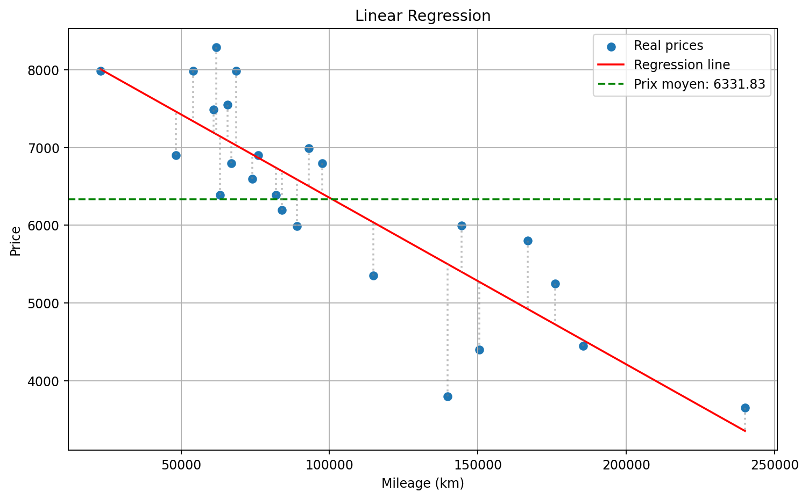

# ft_linear_regression

**Une introduction au machine learning — École 42**

Ce projet consiste à développer **une régression linéaire simple en Python**, sans utiliser de bibliothèque qui effectue l'apprentissage à notre place. L'objectif est de prédire le prix d'une voiture à partir de son kilométrage, en entraînant le modèle grâce à **la descente de gradient**.

Le projet comprend les deux programmes obligatoires (`train.py` et `predict.py`) et les **trois bonus** : visualisation des données, affichage de la droite de régression et mesure de la qualité du modèle avec le coefficient **R²**.

## Aperçu du résultat



**Lecture du graphique :**

- **Points bleus** : prix réels des voitures du fichier CSV.
- **Droite rouge** : prix estimés par la régression linéaire.
- **Ligne verte en pointillés** : prix moyen des voitures.
- **Segments gris en pointillés** : erreurs de prédiction, aussi appelées *résidus*. Plus un segment est long, plus la prédiction s'éloigne du prix réel.

## Fonctionnalités

- **Entraîner** un modèle à partir d'un fichier CSV contenant les colonnes `km` et `price`.
- **Normaliser** les kilométrages pour faciliter la convergence de la descente de gradient.
- **Calculer manuellement** les coefficients `theta0` et `theta1`, sans `numpy.polyfit` ni bibliothèque de machine learning.
- **Sauvegarder** les coefficients dans `theta.json`.
- **Prédire** le prix d'une voiture à partir du kilométrage saisi.
- **Afficher** le nuage de points, la droite de régression, le prix moyen et les résidus.
- **Évaluer** l'ajustement du modèle avec le coefficient de détermination R².
- **Vérifier** les arguments, les données CSV et le contenu du fichier de coefficients.

## Prérequis

- Python 3
- `make`
- Une connexion Internet pour l'installation initiale
- `curl` si `uv` n'est pas encore installé

Le Makefile installe **`uv`** si nécessaire, crée un environnement virtuel `.venv` et installe **Matplotlib** depuis `requirements.txt`. Matplotlib sert uniquement à produire les graphiques.

## Installation

À la racine du projet :

```bash
make
```

Cette commande prépare l'environnement Python et installe les dépendances. Il est également possible d'exécuter directement :

```bash
make install
```

## Utilisation

### 1. Entraîner le modèle

```bash
make train data.csv
```

Le programme lit les données, normalise les kilométrages, exécute la descente de gradient, puis sauvegarde les coefficients dans `theta.json`.

Sortie attendue :

```text
Training completed successfully.
Model trained and saved to theta.json.
```

### 2. Prédire le prix d'une voiture

```bash
make predict
```

Exemple avec 100 000 km :

```text
Enter car mileage: 100000
Estimated price: 6354.70 €
```

Avant le premier entraînement, `theta0` et `theta1` valent tous deux `0`, conformément au sujet. Le programme de prédiction ramène également à zéro tout prix estimé négatif.

### 3. Afficher les bonus

Après l'entraînement :

```bash
make bonus data.csv
```

Avec le fichier fourni :

```text
Model R2 score: 0.7330
```

Une fenêtre Matplotlib affiche le graphique présenté plus haut. Cette commande nécessite que `theta.json` existe déjà.

## Commandes du Makefile

| Commande | Rôle |
| --- | --- |
| `make` | Prépare le projet et installe les dépendances |
| `make install` | Crée `.venv` et installe les dépendances avec `uv` |
| `make train data.csv` | Entraîne le modèle avec le CSV indiqué |
| `make predict` | Demande un kilométrage et affiche le prix estimé |
| `make bonus data.csv` | Affiche le graphique et calcule le R² |
| `make clean` | Supprime `theta.json` |
| `make fclean` | Supprime `theta.json` et `.venv` dans le Makefile fourni |
| `make re` | Nettoie puis réinstalle le projet |

> **Remarque :** si tu appliques aussi la modification proposée pour supprimer `__pycache__` dans `fclean`, cette commande supprimera également le cache Python.

## Fonctionnement de l'algorithme

### 1. La régression linéaire

Le prix est estimé à partir d'une seule variable : le kilométrage.

\[
\widehat{prix} = \theta_0 + \theta_1 \times kilometrage
\]

- **θ₀** : ordonnée à l'origine, c'est-à-dire le prix estimé pour 0 km.
- **θ₁** : pente de la droite, c'est-à-dire la variation du prix estimé pour un kilomètre supplémentaire.

Avec le jeu de données fourni, **θ₁ est négatif** : le prix estimé diminue lorsque le kilométrage augmente.

### 2. La normalisation

Les kilométrages étant beaucoup plus élevés que les prix, le programme les normalise avant l'entraînement :

\[
x_{normalise} = \frac{x - \mu}{\sigma}
\]

- **μ** : moyenne des kilométrages.
- **σ** : écart-type des kilométrages.

Cette transformation facilite la descente de gradient. Après l'entraînement, les coefficients sont **dénormalisés** afin de pouvoir prédire directement à partir des kilomètres réels.

### 3. La descente de gradient

Les coefficients sont initialisés à zéro, puis corrigés progressivement afin de réduire les erreurs entre les prix réels et les prix estimés.

Pour chaque itération :

\[
\theta_0 \leftarrow \theta_0 - \alpha \frac{1}{m}\sum_{i=1}^{m}(\widehat{y_i}-y_i)
\]

\[
\theta_1 \leftarrow \theta_1 - \alpha \frac{1}{m}\sum_{i=1}^{m}(\widehat{y_i}-y_i)x_i
\]

Où :

- **α** est le taux d'apprentissage (*learning rate*).
- **m** est le nombre de voitures.
- **xᵢ** est le kilométrage **normalisé** pendant l'entraînement.
- **yᵢ** est le prix réel et **ŷᵢ** le prix estimé.

Les deux coefficients sont **mis à jour simultanément**, à partir des gradients calculés avec leurs anciennes valeurs.

| Paramètre | Valeur utilisée |
| --- | ---: |
| Taux d'apprentissage | `0.01` |
| Nombre d'itérations | `10000` |
| Variable explicative | Kilométrage (`km`) |
| Valeur à prédire | Prix (`price`) |

### 4. Sauvegarde des coefficients

Après l'entraînement, les coefficients sont enregistrés dans `theta.json` puis réutilisés par `predict.py` et `visualize.py`.

Exemple obtenu avec `data.csv` :

```json
{
  "theta0": 8499.599649933149,
  "theta1": -0.021448963591702085
}
```

Ces coefficients changent si l'on entraîne le modèle avec un autre jeu de données.

## Évaluation du modèle : le coefficient R²

Le coefficient de détermination **R²** compare les erreurs du modèle à celles d'une prédiction qui utiliserait systématiquement le prix moyen :

\[
R^2 = 1 - \frac{\sum_i(y_i-\widehat{y_i})^2}{\sum_i(y_i-\overline{y})^2}
\]

Avec le fichier `data.csv` fourni :

| Indicateur | Résultat |
| --- | ---: |
| Nombre de voitures | **24** |
| Prix moyen | **6 331,83 €** |
| Coefficient R² | **0.7330** |

Un **R² de 0.7330** signifie que le modèle explique environ **73,3 % de la variabilité des prix de ce jeu de données**. Cela **ne signifie pas** que 73,3 % des prédictions sont exactes. Le score est ici calculé sur les données utilisées pour l'entraînement, et non sur un jeu de test indépendant.

La ligne verte du graphique matérialise le prix moyen. Les segments gris montrent les écarts entre les observations et la droite rouge : ce sont ces erreurs qui interviennent dans le calcul du R².

## Format du fichier CSV

Le programme attend un fichier `.csv` dont les colonnes sont exactement `km` et `price`, dans cet ordre :

```csv
km,price
240000,3650
139800,3800
150500,4400
```

Le programme vérifie notamment :

- la présence des deux colonnes et de valeurs numériques finies ;
- l'absence de kilométrages ou de prix négatifs ;
- la présence d'au moins deux lignes de données ;
- l'existence de kilométrages différents, indispensable à la normalisation.

Il est possible d'utiliser un autre jeu de données de même structure :

```bash
make train autre_fichier.csv
make bonus autre_fichier.csv
```

**Attention :** `make bonus` utilise les coefficients du dernier entraînement. Pour analyser ce même entraînement, il faut donc fournir le CSV correspondant.

## Organisation du projet

```text
ft_linear_regression/
├── Makefile
├── README.md
├── requirements.txt
├── data.csv
├── train.py
├── predict.py
├── visualize.py
├── assets/
│   └── regression_graph.png
├── theta.json       # Genere apres l'entrainement
├── .venv/           # Genere par make
└── __pycache__/     # Cache Python eventuel
```

| Fichier | Fonction |
| --- | --- |
| `train.py` | Lecture et validation du CSV, normalisation, descente de gradient et sauvegarde |
| `predict.py` | Chargement des coefficients, saisie du kilométrage et prédiction |
| `visualize.py` | Graphique, droite de régression, prix moyen, résidus et calcul du R² |
| `Makefile` | Installation et commandes de lancement |
| `requirements.txt` | Dépendance Matplotlib |
| `data.csv` | Jeu de données d'exemple |
| `assets/regression_graph.png` | Illustration du résultat pour le README |

Pour éviter de versionner les fichiers générés automatiquement, un `.gitignore` peut contenir :

```gitignore
.venv/
__pycache__/
*.pyc
theta.json
```

## Correspondance avec le sujet de 42

### Partie obligatoire

- [x] Prédire le prix d'une voiture à partir de son kilométrage.
- [x] Implémenter la régression linéaire et la descente de gradient.
- [x] Initialiser `theta0` et `theta1` à zéro avant l'entraînement.
- [x] Mettre à jour les deux coefficients simultanément.
- [x] Sauvegarder puis réutiliser les coefficients calculés.

### Bonus

- [x] Représenter la distribution des données sur un graphique.
- [x] Ajouter la droite de régression sur le même graphique.
- [x] Calculer une mesure de précision du modèle : **R²**.

**Améliorations visuelles supplémentaires :** affichage du prix moyen et des résidus.

## Limites du modèle

- Le modèle ne prend en compte que le **kilométrage** : l'âge, la marque et l'état du véhicule influencent aussi son prix.
- Le R² affiché mesure l'ajustement sur les données fournies, pas la précision sur de nouvelles voitures.
- `predict.py` empêche les prix négatifs, tandis que le graphique et le R² utilisent la formule linéaire sans cette limitation.
- Les prédictions très éloignées des kilométrages du jeu de données peuvent être peu fiables.

## À propos

Projet réalisé dans le cadre de **ft_linear_regression — École 42**, sujet version 4.1.
